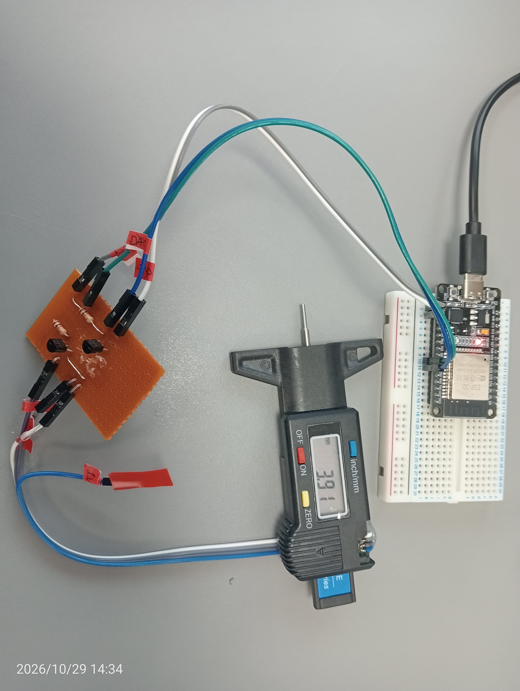

# ESP32 Digital Linear Displacement Sensor Interface & Data Logger

An ESP32-based hardware interface and Python data logging pipeline for digital displacement gauges, linear encoders, and precision measuring instruments (using the 24-bit caliper protocol). 

This project taps into the raw serial output lines of a battery-powered gauge, uses transistor-based level shifting and logic inversion to feed the signals safely into an ESP32, decodes the synchronous stream via high-speed interrupts, and provides real-time desktop visualisation with live velocity/acceleration plotting, a digital LED readout, and CSV export capabilities.

> **Note**: The hardware interface and software decoding logic in this repository are modified from the original design by [Ipsilon Development](https://www.ipsilondev.com/maker/en/digital-gauge-arduino.php).

---

## Features

- **Hardware Level Shifting & Logic Inversion**: Converts 1.5V clock and data signals from the gauge to 3.3V logic for the ESP32 while inverting collector output.
- **Interrupt-Driven Decoding**: Uses ESP32 hardware interrupts (`IRAM_ATTR`) on clock falling edges to decode the 24-bit measurement packet with frame-synchronisation detection.
- **Real-Time Data Streaming**: Outputs cleaned, scaled measurement values (in mm) over USB Serial at 115200 baud.
- **Python Desktop Dashboard**: Includes a Tkinter + Matplotlib GUI application (`Digital_Gauge_Dash.py`) for live scrolling plotting, auto-ranging viewport, auto-detection of COM ports, and CSV dataset export.
- **Repeatability & Accuracy Analysis**: Designed for statistical analysis, tyre wear tracking, and measurement variance studies.

---

## Hardware Architecture & Setup

### Logic & Level Shifting

Digital calipers and tread depth gauges natively operate on a single 1.5V button cell (`LR44` / `SR44`). Their data (`DATA`) and clock (`CLK`) signals operate at 1.5V CMOS levels, which cannot reliably trigger ESP32 digital inputs (minimum $V_{IH} \approx 2.4\text{V}$).


To solve this, two NPN transistors (such as the **2N4401G**, acting as a drop-in replacement for `2N2222` or `BC547`) are arranged in a common-emitter configuration with pull-up resistors:

1. When the gauge signal is **HIGH** (1.5V), the transistor turns on, pulling the ESP32 GPIO pin to **LOW** (0V).
2. When the gauge signal is **LOW** (0V), the transistor turns off, allowing the pull-up resistor to pull the ESP32 GPIO pin to **HIGH** (3.3V).

> **Note**: This circuit inverts the signal logic. Consequently, the firmware handles bit reading with inverted logic (`LOW` = Binary 1, `HIGH` = Binary 0) and triggers interrupts on the `FALLING` edge.

### Component Connection Wiring (Per Channel: CLK & DATA)

| Connection Point | Component / Pin | Description |
|---|---|---|
| **Digital Gauge Signal** (`CLK` or `DATA` at 1.5V) | Series Resistor | Connects from the gauge output pin through a base resistor (e.g., $10\text{k}\Omega$) into the transistor base. |
| **Transistor Base** (`B` of 2N4401G) | Resistor Output | Receives the scaled 1.5V signal from the gauge. |
| **Transistor Emitter** (`E` of 2N4401G) | Ground (`GND`) | Tied directly to the common ground rail. |
| **Transistor Collector** (`C` of 2N4401G) | ESP32 GPIO Pin & Pull-up | Tied to the corresponding ESP32 pin (**GPIO 18** for CLK, **GPIO 19** for DATA) and connected via a pull-up resistor ($10\text{k}\Omega$) to the 3.3V rail. |
| **Common Ground** | `GND` | Digital gauge ground and ESP32 GND tied together. |

   
### Pin Map

| ESP32 Pin | Function | Description |
|---|---|---|
| **GPIO 18** | `CLOCK_PIN` | Serial clock input (Interrupt attached, falling edge) |
| **GPIO 19** | `DATA_PIN` | Serial data input (Sampled on clock pulse) |
| **GND** | Ground | Common ground reference with interface board |

### Hardware Assembly 

<div align="center">
  
  <br>
  <em>Figure 1: Hardware prototype showing the digital gauge wired via the transistor-based level shifter interface board to the ESP32 microcontroller.</em>
</div>

---

## Data Protocol Specification

The digital depth gauge transmits data as a continuous stream of 24-bit packets:

1. **Frame Synchronisation**: A clock idle time exceeding ~3ms indicates a new packet boundary.
2. **Bit Structure**:
   - **Bits 0–19**: Core measurement value in units of $0.01\text{ mm}$ (LSB transmitted first).
   - **Bit 20**: Sign bit (`0` = positive, `1` = negative).
   - **Bits 21–23**: Reserved/Units flags.
3. **Conversion**:
   $$\text{Distance (mm)} = \frac{\text{Raw 20-bit Integer}}{100.0} \times (\text{Sign Bit} ? -1 : 1)$$

---

## Software Setup & Usage

### 1. ESP32 Firmware

1. Open `Digital_Depth_Gauge_Stream.ino` in the Arduino IDE or PlatformIO.
2. Ensure the ESP32 board support package is installed.
3. Select your ESP32 target board and COM port.
4. Upload the code.
5. Open the Serial Monitor at **115200 baud** to verify live measurement output.

### 2. Python Visualisation Dashboard

<div align="center">
  
  <br>
  <em>Figure 2: Real-time demonstration of the Python dashboard capturing digital gauge measurements live over serial.</em>
</div>

#### Dependencies
Install the required packages using pip:
```bash
pip install pyserial matplotlib
